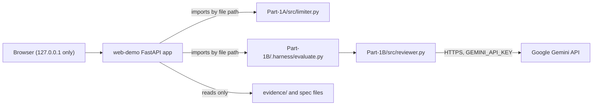
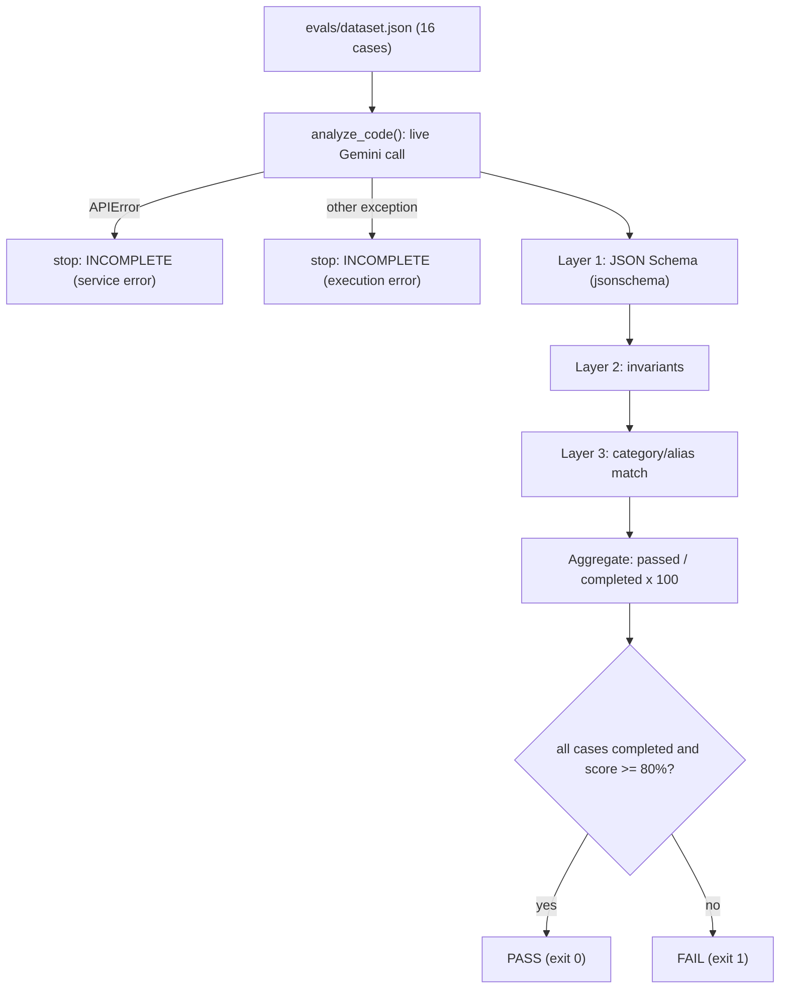

# Architecture

This repository holds three components:

| Component | Folder | Kind | Role |
|---|---|---|---|
| Tiered rate limiter | `Part-1A/` | Deterministic Python component | Assignment Part 1A |
| AI security code reviewer and its evaluation harness | `Part-1B/` | Non-deterministic (live Google Gemini) | Assignment Part 1B |
| Web demonstration portal | `web-demo/` | Local FastAPI app with HTML/CSS/JavaScript | Presents and runs Parts 1A and 1B; changes neither |



---

## Part 1A: tiered rate limiter (`Part-1A/src/limiter.py`)

**Algorithm: Token Bucket**, one bucket per client ID, kept in process memory.

| Tier | Capacity (`TIERS`) | Refill rate |
|---|---:|---|
| `free` | 5 | 5 tokens per 60 s |
| `standard` | 20 | 20 tokens per 60 s |
| `premium` | 100 | 100 tokens per 60 s |

- **`TokenBucket.consume()`**: adds `elapsed seconds × refill_rate` tokens (capped at
  capacity), then takes one token if at least one is available.
- **`TokenBucket.time_until_next_token()`**: the smallest whole number of seconds after which
  one token is available. It rounds **up** (with a `1e-9` tolerance for floating-point noise
  such as `1 / (5/60) = 12.000000000000002`) and then confirms the value is sufficient using
  the same arithmetic as `consume()`. This is the 2026-11-07 repair of acceptance criterion AC3
  (see `Part-1A/speckit.specify.md`, Clarifications).
- **`RateLimiter.check_request(client_id, tier)`**: creates the client's bucket on its first
  request. The tier is fixed by that first request, and an unknown tier falls back to `free`.
  When the bucket is empty it raises FastAPI `HTTPException(429, headers={"Retry-After": n})`.

Part 1A is a component, not a deployed service. Its state lives in one process: it is lost on
restart and not shared between workers.

---

## Part 1B: AI security code reviewer (`Part-1B/src/reviewer.py`)

`analyze_code(code: str) -> str` returns a JSON string with this contract:

```json
{"status": "success | error",
 "findings": [{"vulnerability": "...", "severity": "High | Medium | Low",
               "description": "...", "evidence": "...", "remediation": "..."}]}
```

Flow of one call:

1. **Input check.** A non-string raises `TypeError`. Blank or whitespace-only input returns
   `{"status": "error", "findings": []}` **without** calling the model (dataset case 16).
2. **Prompt.** The code is placed between `<<<SOURCE_INPUT_START` and `SOURCE_INPUT_END>>>`
   markers and declared untrusted. The rules tell the model to ignore embedded instructions,
   report only issues supported by the input, quote evidence exactly, use only High, Medium or
   Low, and report prompt-injection attempts.
3. **Model call.** `google-genai` client, model `gemini-3.5-flash-lite` (override with
   `GEMINI_MODEL`), `response_mime_type="application/json"`, a response schema,
   `temperature=0.1`, `max_output_tokens=2048`. The key comes only from the `GEMINI_API_KEY`
   environment variable.
4. **Local validation** (`_validate_response`): JSON object, valid status, findings is a list,
   all five fields are non-empty strings, allowed severity. Failures raise `ValueError`.
   Service failures raise the SDK's `APIError` types. **No mock or fallback output is ever
   returned.**

### Evaluation harness (`Part-1B/.harness/evaluate.py`)



- **Layer 1, structure:** the response validates against the JSON Schema (required fields,
  types, severity enumeration).
- **Layer 2, invariants:** an `error` status has no findings; the status equals the case's
  `expected_status` (default `success`; `error` for case 16); at most 10 findings; valid
  severities; every `evidence` value is an exact substring of the submitted code.
- **Layer 3, semantic:** a deterministic category/alias match. Finding labels and the
  configured aliases (`SEMANTIC_ALIASES`) are normalised (lower case, non-alphanumerics
  removed), and a case passes if any alias of the expected category appears in any finding
  label. Cases whose expected category is `None` must return no findings. **This is not an
  LLM judge.**
- **Aggregate:** a case passes only if all three layers pass. Score = passed ÷ completed × 100;
  the threshold is 80%. The first service error (`APIError`) or execution error stops the run
  as `INCOMPLETE` (exit code 2) with no final score, so outages are not counted as
  application failures.
- **Traceability:** before writing `evidence/eval-results.json`, the previous report is
  archived as `eval-results-run-<N>-<score>pct.json` (or `-incomplete`). Each report records
  `dataset_sha256`, a SHA-256 of the dataset's canonical JSON (sorted keys, compact
  separators), so it does not depend on line endings.

---

## Web demonstration portal (`web-demo/`)

Built through the full GitHub Spec Kit sequence: `web-demo/.specify/memory/constitution.md` and
`web-demo/specs/001-web-demo-portal/` (spec, clarifications, plan, research, data model,
contracts, tasks).

**Backend** (`web-demo/app/`, FastAPI, served by uvicorn on `127.0.0.1` only):

| Module | Responsibility |
|---|---|
| `main.py` | `create_app()` factory: settings, middleware stack, routers, static files |
| `backends.py` | Loads `limiter.py` and `evaluate.py` with `importlib` under unique module names, without writing bytecode into Part 1A/1B |
| `routes/part1a.py` | One shared `RateLimiter` instance; `/api/part-1a/{tiers,request,reset,harness}` |
| `routes/part1b.py` | `/api/part-1b/analyze`: calls the real `analyze_code` in a worker thread, one analysis at a time (409 when busy), 60 s timeout, then runs the evaluator's own Layer 1 and Layer 2 checks on the result |
| `routes/evaluation.py` | Read-only saved evaluation reports and run history |
| `routes/evidence.py`, `evidence_index.py` | Allow-listed evidence files by opaque ID, with SHA-256 |
| `security.py` | Security headers and CSP, same-origin POST check, 64 KB body limit, trusted hosts, safe error envelope |
| `errors.py` | Error categories: Gemini failures are classified (`quota`, `service_error`, `network_timeout`, `not_configured`, `invalid_model_output`) and never returned as findings |

**Frontend** (`web-demo/static/`): one HTML page with six sections and vanilla JavaScript
modules, no build step and no third-party scripts. All server and model data is inserted
with `textContent`, never as HTML.

**Security properties** (each checked by tests in `web-demo/tests/`):

- The API key stays in the server environment and appears in no response, header, static
  file or log (`test_secret_sweep.py`).
- Submitted code is sent to Gemini but never executed, stored or logged.
- Content-Security-Policy without `unsafe-inline` or `unsafe-eval`.
- Evidence is served by ID from an allow-list, so file paths cannot be requested.

Full details: [web-demo/README.md](../web-demo/README.md) and the contracts in
`web-demo/specs/001-web-demo-portal/contracts/`.
